<div align="center">
  
</div>

# artifact-tracker

> Log artefacts dropped during an engagement for clean-up

Part of a red-team tooling collection for **authorised** security testing.

## Install

```bash
git clone https://github.com/amooryx/artifact-tracker.git
cd artifact-tracker
```

## Usage

```bash
python artifact_tracker.py <target>
```

| Flag | Description |
|---|---|
| `-o, --output` | Specify an output path (reserved; this scaffold does not write results) |
| `-v, --verbose` | Verbose output |
| `-y, --yes` | Skip the authorisation prompt |

The current implementation is a workflow scaffold: it validates the authorisation
gate and prints the selected target, but does not perform engagement checks or
write an output file. If the authorisation prompt reaches end-of-file (for example,
when stdin is closed), it refuses to run.

Run the local regression tests with:

```bash
python -m unittest discover -s tests
```

## Disclaimer

> **Authorised security testing only.** Use this against systems you own or have
> explicit written permission to test. The tool prompts for authorisation before
> acting and is provided for professional engagements, labs, and research.

## Author

**Omar Khalid** — [omareldemery.com](https://omareldemery.com) | [@amooryx](https://github.com/amooryx)

Certifications: OSCP+ · OSCP · CRTP · eWPTX · eCPPT · eCDFP · eCIR · eJPT
